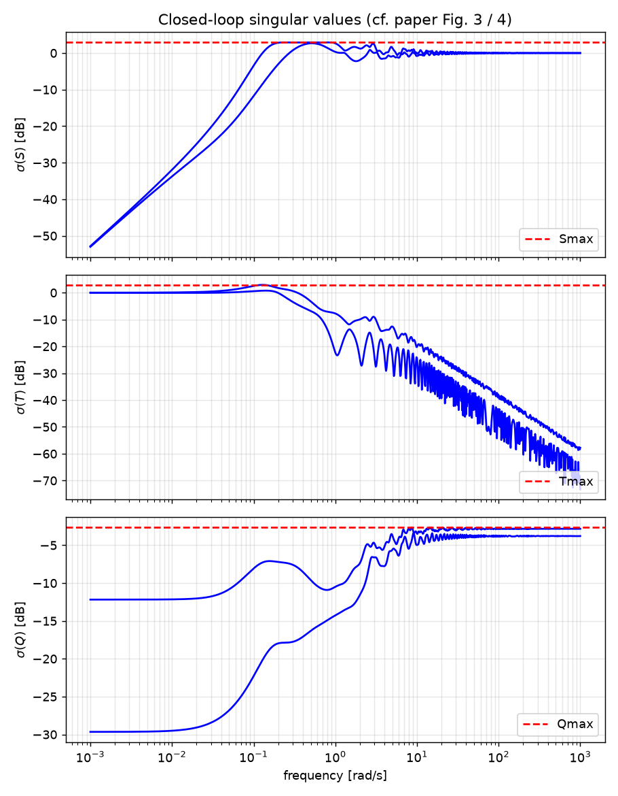
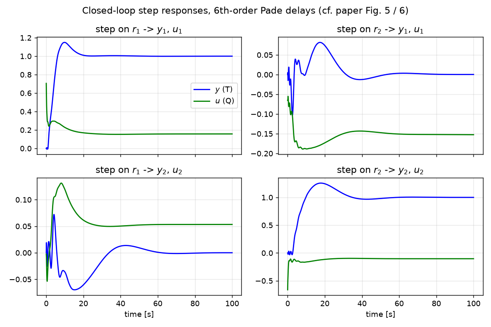
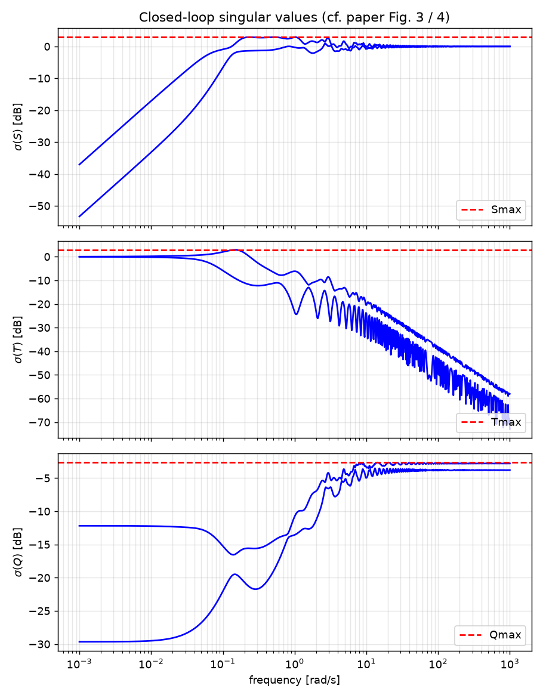

# MIMO PID tuning via iterated LMI restriction (Python)

A Python/cvxpy implementation of

> S. Boyd, M. Hast and K. J. Åström, **"MIMO PID tuning via iterated LMI restriction"**,
> *Int. J. Robust & Nonlinear Control*, 26:1718–1731, 2016.
> [PDF](https://web.stanford.edu/~boyd/papers/pdf/mimo_pid_tuning.pdf)

The paper's Wood–Berry distillation-column example is reproduced to within the
printed precision of the published gains (see [Results](#results)).

## What the method does

Given a stable plant `P(s)` (sampled on a frequency grid `w`), find the gains of a
MIMO PID controller

    C(s) = Kp + Ki / s + Kd s / (1 + tau s)

that give the best low-frequency disturbance rejection subject to classical
loop-shaping limits:

    minimize    ||(P(0) Ki)^-1||
    subject to  ||S(jw)|| <= Smax,   S = (I + P C)^-1      (sensitivity peak)
                ||T(jw)|| <= Tmax,   T = P C S             (complementary sensitivity peak)
                ||Q(jw)|| <= Qmax,   Q = C S               (actuator effort)

Each constraint is a quadratic matrix inequality `Z*Z ⪰ Y*Y` in the gains. It is
replaced by the linear matrix inequality (LMI)

    [ Z*Z0 + Z0*Z - Z0*Z0   Y* ]
    [ Y                     I  ]  ⪰ 0

which is a convex *restriction* of the original constraint, tight at the
linearisation point `Z0`. Starting from a low-gain feasible controller
`Ki = eps * pinv(P(0))`, the SDP is solved, the solution becomes the new
linearisation point, and the process repeats. Every iterate is feasible and the
objective is non-increasing; convergence typically takes fewer than 10 iterations.

## Installation

```bash
git clone https://github.com/salemon/MIMO_PID_LMI
cd MIMO_PID_LMI
python -m venv .venv && source .venv/bin/activate     # or: uv venv .venv
pip install -r requirements.txt                       # or: uv pip install -r requirements.txt
```

Dependencies: `numpy`, `scipy`, `cvxpy` with an SDP solver (`clarabel` is the
default, `scs` also works), `matplotlib` and `python-control` for the example
plots. Slycot is **not** required.

## Quick start

```bash
python wood_berry_example.py            # paper setup: N = 300 frequencies, ~2.5 min
python wood_berry_example.py -N 60      # coarser grid, ~30 s, nearly identical gains
python wood_berry_example.py --diagonal # decentralised (diagonal) PID, paper Fig. 4
pytest -q                               # regression test against the paper's numbers
```

Using the solver in your own code:

```python
import numpy as np
from auto_mimo_pid import auto_mimo_pid, fotd_plant, closed_loop_sigmas

# P_ij(s) = K_ij exp(-L_ij s) / (T_ij s + 1); delays are evaluated exactly
P = fotd_plant(K=[[12.8, -18.9], [6.6, -19.4]],
               T=[[16.7, 21.0], [10.9, 14.2]],
               L=[[1.0, 3.0], [7.0, 3.0]])

w    = np.logspace(-3, 3, 300)
Qmax = 3 / np.linalg.svd(P(0).real, compute_uv=False).min()

res = auto_mimo_pid(P, w, Smax=1.4, Tmax=1.4, Qmax=Qmax, tau=0.3)
Kp, Ki, Kd = res["Kp"], res["Ki"], res["Kd"]
print(res["objval"])                      # ||(P(0) Ki)^-1||

S, T, Q = closed_loop_sigmas(P, res["controller"], w)   # singular values on the grid
```

`P` can be any callable `w -> P(jw)` (complex `(p, m)` array) or a
`python-control` LTI/FRD object. Pass a list of plants to enforce the
constraints for several plant cases at once (robust design, paper Section 7).

### Options

| key         | meaning                                                            | default |
|-------------|--------------------------------------------------------------------|---------|
| `epsilon`   | gain of the initial controller `Ki = eps * pinv(P(0))`             | `0.01`  |
| `initial`   | dict `{"Kp", "Ki", "Kd"}` to start from instead                    | –       |
| `structure` | dict of 0/1 masks; zero entries are forced to zero (e.g. diagonal) | –       |
| `max_iter`  | maximum number of SDP solves                                       | `10`    |
| `tol`       | stop when the SDP objective `t` changes by less than this          | `1e-3`  |

Keyword arguments `solver="CLARABEL"` / `"SCS"` and `solver_opts={...}` are
forwarded to cvxpy.

## Results

Wood–Berry column, `Smax = Tmax = 1.4`, `Qmax = 3/σmin(P(0)) = 0.738`, `τ = 0.3`,
300 log-spaced frequencies in `[1e-3, 1e3]`, `ε = 0.01` (exactly the paper's setup).

| | this code (N = 300) | paper (p. 1727) |
|---|---|---|
| `Kp` | `[[ 0.1753 -0.0487] [-0.0739 -0.0698]]` | `[[ 0.1750 -0.0470] [-0.0751 -0.0709]]` |
| `Ki` | `[[ 0.0906 -0.0348] [ 0.0398 -0.0328]]` | `[[ 0.0913 -0.0345] [ 0.0402 -0.0328]]` |
| `Kd` | `[[ 0.1589 -0.0050] [ 0.0214 -0.1778]]` | `[[ 0.1601 -0.0051] [ 0.0201 -0.1768]]` |
| objective `‖(P(0)Ki)⁻¹‖` | **2.257** | **2.25** |
| iterations | 8 | 7 |
| wall time | 150 s (Clarabel, laptop) | 153 s (SDPT3, desktop) |
| peak ‖S‖, ‖T‖, ‖Q‖ on a 3000-pt grid | 1.400, 1.400, 0.739 | ≤ 1.4, 1.4, 0.738 |




Diagonal PID (`--diagonal`, paper p. 1729), initialised with the paper's low-gain
PI controller `Kp = Ki = 1e-3 diag(1, -1)`:

| | this code (N = 300) | paper |
|---|---|---|
| `diag(Kp)` | `[0.1479, -0.0704]` | `[0.1535, -0.0692]` |
| `diag(Ki)` | `[0.0189, -0.0141]` | `[0.0210, -0.0136]` |
| `diag(Kd)` | `[0.1731, -0.1728]` | `[0.1714, -0.1725]` |
| objective `‖(P(0)Ki)⁻¹‖` | **14.07** | **13.36** |
| iterations | 7 | 8 |

The diagonal design is still improving by ~1 % per iteration when the default
stopping rule (`tol = 1e-3` on `t`) fires; use `options={"tol": 1e-4}` to run
it closer to the paper's value.



The remaining differences are at the level of the solver tolerance and the
stopping rule; the paper uses SDPT3 through CVX, this code uses Clarabel through
cvxpy.

## Files

| file | content |
|---|---|
| `auto_mimo_pid.py`      | the algorithm (`auto_mimo_pid`), plant helper (`fotd_plant`), analysis helpers |
| `wood_berry_example.py` | reproduces Section 8 of the paper, writes `figures/` |
| `test_wood_berry.py`    | pytest regression test against the paper's gains |
| `requirements.txt`      | Python dependencies |

## Notes on the implementation

* The LMIs are complex Hermitian at every frequency. cvxpy handles complex PSD
  constraints natively; the blocks use the conjugate transpose (`.H`), not `.T`,
  and the imaginary parts are **not** discarded.
* Time delays are evaluated exactly in the frequency domain, so no Padé
  approximation enters the design. A 6th-order Padé approximation is used only
  for the step-response plots.
* The objective is handled as in the MATLAB reference: maximise `t` subject to
  `σmin(P(0) Ki) ≥ t`, so `t` is a lower bound on `1/objective` that becomes
  tight at convergence.
* The MATLAB implementation
  [rubindan/mimoPIDtune](https://github.com/rubindan/mimoPIDtune) (YALMIP/SeDuMi)
  was used as a reference for the structure of the code. It initialises with
  `ε = w[0]/10 = 1e-4` instead of the paper's `0.01`; both converge to the same
  controller, the paper's value simply saves one or two iterations.

## License

MIT, see `LICENSE`.
